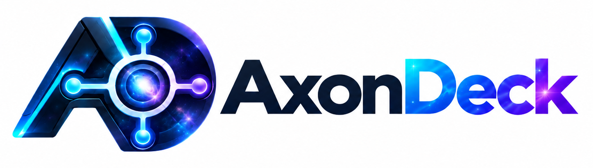

<p align="center"></p>

# AxonDeck

Windows 桌面 AI 工作台：AI 對話、專案終端機、本機大型語言模型、語音轉文字、翻譯、文字轉語音、生成圖片影像、系統監控，全部放在同一個 App。語音與翻譯可以完全離線跑本地模型，也能改用雲端 API。

**目前版本 v1.69.0** — [下載安裝檔](https://github.com/RX5950XT/AxonDeck/releases)（裝好後在 App 內自動更新）

> v1.69.0：AGY 反代支援生圖，更新模型清單並改善工具呼叫相容性。
>
> v1.68.0：切頁、Git 面板、檔案頁、系統監控不再突然頓一下（切回已開過的頁最慢 0.65 秒 → 0.09 秒），最近 7 天用過的頁開機後先在背景載好；文字轉語音改版（女聲範本試聽、底部播放列、生成可排隊、自動整理音量與頭尾靜音）；額度條延伸到右側欄下方並顯示 App 資源佔用；Git 面板新分支一鍵發布。
> 歷次更新見 [Releases](https://github.com/RX5950XT/AxonDeck/releases)。

---

## 頁面一覽

導覽列共十頁，可拖曳換順序。每頁是獨立程序，一頁當掉不會拖垮整個 App。

| 頁面 | 做什麼 |
|---|---|
| **Super Intelligence** | AI 對話（雲端／本機模型）、ChatGPT／Gemini／Claude／Grok 網頁版、專案工作區＋終端機＋內建瀏覽器 |
| **Telegram** | Telegram 網頁版，最多 4 格並排 |
| **檔案** | 整機檔案總管，操作跟 Windows 檔案總管一樣 |
| **語音轉文字** | 檔案轉錄、錄音機、即時字幕、全域語音輸入 |
| **翻譯** | 文字翻譯（不限字數）、螢幕翻譯、PDF／圖片保留版面翻譯 |
| **文字轉語音** | 本機 Breeze-TTS-2：聲音設計、語音克隆、語氣指導、字幕配音 |
| **生成圖片影像** | 內嵌 Miroxen：Qwen-Image 生圖、MiniMax-H3 生有聲影片 |
| **系統監控** | 硬體規格與即時讀數、使用時長、處理程序、風扇、效能調整、壓力測試、磁碟空間 |
| **Local SI** | 從 Hugging Face 搜尋、下載、載入 GGUF 模型，自動決定最佳參數 |
| **設定** | 雲端模型、外觀、AGY 反代、軟體安裝與更新、AI CLI 版本 |

---

## 功能

### AI 對話與網頁版 AI

- 走 OpenAI 相容端點，可掛多組供應商，模型下拉依供應商分組；按「掃描」從 `/models` 挑要用的模型。
- 逐字串流、可停止；支援圖片輸入、生圖模型、思考強度（8 檔）、多組系統提示、重新生成、編輯與分叉。
- 側欄一鍵新增 ChatGPT、Gemini、Claude、Grok 網頁版對話，每則記住自己的網址與標題；Google 登入不會被擋。
- 對話可分資料夾、搜尋、拖曳排序，右鍵改名或刪除。

### 專案工作區與終端機

- 專案＝本機資料夾，分頁可放終端機、Monaco 編輯器、內建瀏覽器；右側欄有檔案樹（含全文搜尋）、Git、AI 記錄、MCP／Skills。
- 終端機跑在 App 外的獨立程序：App 重開或更新，Claude Code、Codex、Grok、OpenCode、Antigravity 都能接回原對話。
- 分頁顯示 AI 狀態（運行中／等你回答／閒置）與上下文用量；背景 agent 完成或在等你時跳 Windows 通知。
- 右緣對話清單可跳到任一則提問；最多 3 格並排；支援管理員終端機、桌布與配色、Ctrl+G 用 App 內編輯器。
- `Ctrl+Shift+P` 指令面板、一鍵建 worktree 並開 agent、Git 面板按鈕依狀態變化（全部提交、發布分支）。
- 內建瀏覽器支援 Chrome 擴充功能（商店或本機資料夾安裝）、垂直分頁與分組、閒置 1 小時自動休眠。
- 檔案預覽：Markdown（Mermaid、數學、程式碼上色、提示框）、HTML、Office 文件、圖片影音、超過 256MB 的文字檔唯讀分段檢視。

### 額度條（終端機下方）

- 集中看 Claude Code、Codex、Antigravity、OpenCode Go、Grok、Ollama Cloud、Command Code 的已用額度與重置倒數，全部走官方端點。
- 抽屜：**供應商**（切換 Claude Code 用哪家，非 Anthropic 走本機轉換閘道；Claude 官方訂閱可存多帳號切換）、**用量統計**（掃本機 CLI 紀錄算實際 token 與美金）、**Port**（本機在聽的埠）、**資源**（App 各頁與子程序佔用）。
- 提醒：週窗口快重置卻還剩很多、Codex 重置次數快過期；可設定時間自動預熱 5 小時窗口。

### 檔案

- 分頁、雙欄、方格真縮圖、詳情欄、資料夾大小、資源回收筒、Ctrl+Z 復原、拖放到別的程式。
- 搜尋可切「整台電腦」（UFFS，Everything 等級速度）或「只篩這個資料夾」。
- 原生右鍵選單（7-Zip、WinRAR、傳送到）、ZIP 唯讀瀏覽、手機（MTP）瀏覽。
- 圖片、影音用獨立原生播放器開；文字檔用 App 內編輯器開（可設為 Windows 預設開啟程式）。

### 原生媒體播放器

- 點圖片、動畫、影片、音樂直接開獨立視窗；支援動態 WebP、GIF、HEIC、JXL、PSD 與常見影音格式。
- 播放清單（搜尋、拖入、續播）、倍速、逐格、字幕時間微調、截圖、置頂；**F1** 看全部快捷鍵。
- 跟 AxonDeck 分開運行，一邊當掉不影響另一邊。不支援 DRM、MIDI；CUE 播整個音檔。

### 語音轉文字

- **檔案轉錄**：拖入 MP3／WAV／M4A／FLAC 等，最長 4 小時／200MB；雲端遇限流會重試，失敗也保留已完成的部分。
- **錄音機**：麥克風／系統聲音／兩者混音，每秒寫入硬碟；錄好可直接拖去轉錄。
- **即時字幕**：擷取電腦正在播的聲音，在自然停頓處切句、轉錄並翻譯，顯示在置頂懸浮字幕；每場自動留逐字稿。
- **語音輸入**：在任何程式裡按住右 Alt 講話，放開就貼上整理好的文字（去贅字、補標點、條列）；個人字典會自己學。

### 翻譯

- 雙欄輸入／譯文，不限字數、自動分段；可用 Edge TTS 朗讀（繁中、簡中、英文、日文）。
- **術語表**：翻成繁中時套臺灣譯名；內建國家教育研究院學術名詞約 21 萬條，可加自訂詞條。
- **螢幕翻譯**：半透明置頂取景框，畫面變了自動 OCR 並翻譯，相同原文不重翻。
- **檔案翻譯**：PDF 或圖片逐頁辨識、翻譯，盡量保留原版面、公式與圖形，輸出新 PDF；可選頁碼、雙語對照，有 NVIDIA 顯示卡可裝 GPU 加速（快 2～3 倍）。複雜文件仍需人工核對。

### 文字轉語音

- 本機 **Breeze-TTS-2 Q8_0**，中文與英文：聲音設計（有女聲範本可試聽）、語音克隆（選參考音後自動辨識逐字稿）、語氣指導、實驗性變聲。
- 整段／逐句／字幕（SRT、VTT、ASS）配音，讀音字典、單句重做、版本保留、生成排隊、邊生成邊試聽、匯出 WAV。
- 也可切換成雲端 OpenAI 相容 `/audio/speech`。參考音訊不會上傳；[官方模型](https://huggingface.co/BreezeBlue/Breeze-TTS-2)與輸出限研究、非商業用途。

### 生成圖片影像

- 內嵌 [Miroxen](https://github.com/RX5950XT/Miroxen) 工作台：Qwen-Image-2.1 生成與編輯圖片、MiniMax-H3 生成有聲影片。
- 需要 NVIDIA RTX 30 以上、驅動 580 以上；引擎與模型在 Local SI 安裝與更新。
- 有 API 網址與金鑰；可開「允許區網其他裝置連線」（請只在信任的網路開）。

### 系統監控

- **總覽**：CPU／記憶體／磁碟／網路即時曲線與完整硬體規格；硬碟健康度免提權讀取。
- **使用時長**：應用與網站的日／週／月／年統計（相容 Tai 的紀錄與瀏覽器外掛）。
- **處理程序**：依 CPU／記憶體／磁碟／GPU／網路排序，可強制結束。
- **風扇控制**：可拖點的轉速曲線、識別鈕；**效能調整**：PBO、Curve Optimizer、鎖頻、電壓、GPU V/F（只在本次開機有效，過熱自動還原）；**壓力測試**：CPU、GPU、記憶體、磁碟。
- **磁碟空間**：treemap 找大檔，刪除只丟回收筒。
- 溫度、功耗、轉速需要一顆提權的感測器元件（進頁時問一次 UAC）；不給也能用，只是那幾格空著。

### Local SI（本機模型）

- **探索**：搜尋 Hugging Face 的 GGUF，還沒下載就算得出「這台跑不跑得動」。
- **執行環境**：一鍵安裝 llama.cpp（有夠新的 NVIDIA 驅動裝 CUDA 版，否則 Vulkan 版），啟動、載入、卸載、看佔用都在同一頁。
- **自動調參**：實際載入量記憶體、實測比較幾組參數，挑最快的套用；每一項都能手動覆寫。
- 載入的模型直接出現在 AI 對話的模型選單；另有本機 API 可給其他工具用。

### AGY 反代與設定

- **AGY 反代**：把本機 Antigravity 登入轉成 OpenAI（`/v1/chat/completions`）與 Anthropic（`/v1/messages`）相容 API，另支援生圖（`/v1/images/generations`）；只聽 `127.0.0.1`、強制金鑰，附流量日誌與統計。
- **安裝**：常用軟體一鍵安裝，WinGet 已安裝程式的更新與解除安裝；更新失敗自動改用管理員權限或原廠安裝程式重試。
- **CLI 版本**：Claude Code、Codex、Grok、OpenCode 等的版本檢查、安裝與更新。
- 主題深淺色、終端機外觀、開機自啟動、關視窗留在系統匣、自動更新。

---

## 推薦本地模型

在 Local SI「推薦」一鍵下載，全部固定版本並比對 SHA-256，存在 `%APPDATA%/axondeck/models/`。有 NVIDIA 顯示卡（8GB 以上）自動用 GPU，否則用 CPU。

| 模型 | 用途 |
|---|---|
| Qwen3-ASR 0.6B／1.7B（Q8_0） | 語音辨識，52 種語言（含國／粵／閩語），中文輸出自動轉臺灣繁體 |
| LinguaForge 0.8B（Q4_K_M） | 本地翻譯，繁中／英／日專用微調 |
| Index-Translate 2B（Q4_K_M） | 本地翻譯，多語 |
| PaddleOCR-VL-1.6、PP-DocLayoutV3 | 螢幕翻譯與 PDF 翻譯的文字與版面辨識 |
| Breeze-TTS-2（Q8_0，約 3.32 GiB） | 文字轉語音 |
| Qwen-Image-2.1、MiniMax-H3 | 生成圖片、有聲影片（Miroxen） |

---

## 技術棧

- **核心**：Electron 43.7.5；前端 Vite＋Vanilla JS／HTML／CSS（無框架）
- **原生元件**：Rust（終端機宿主、系統取樣、用量掃描、媒體播放器）、.NET（殼層、感測器、熱鍵）
- **本地推論**：llama-server router（GGUF）、Breeze-TTS-2.cpp、Miroxen（C++／CUDA）、隔離 Python（PDF 翻譯）
- **其他**：xterm.js、Monaco、pdf.js、node-pty、opencc-js、Edge TTS、`node:sqlite`

---

## 開發

```bash
npm install
npm run electron:dev     # 開發模式（vite + electron）
npm run dev:sandbox      # 沙箱實例，不影響正在用的那份
npm run lint             # ESLint＋IPC 對齊檢查
node scripts/run-tests.js   # 全部單元測試
npm run electron:pack    # 免安裝預覽 → dist/win-unpacked/
npm run electron:build   # NSIS 安裝檔 → dist/
```

原生元件（沒建也能打包，只是對應功能降級）：`npm run build:probe`（需 Rust）、`build:media`（需 Rust、7-Zip、VS C++ build tools）、`build:shell`／`build:sensors`／`build:hook`（需 .NET SDK）。

架構與交接見 [CONTEXT.md](./CONTEXT.md)，開發規範見 [AGENTS.md](./AGENTS.md)，待辦見 [tasks/todo.md](./tasks/todo.md)，歷史教訓見 [tasks/lessons.md](./tasks/lessons.md)。

---

## 授權

GPL-3.0（內建瀏覽器的 Chrome 擴充功能支援使用 [electron-chrome-extensions](https://github.com/samuelmaddock/electron-browser-shell)，授權為 GPL-3.0），全文見 [LICENSE](./LICENSE)。原生媒體播放器相依元件授權見 `resources/media-NOTICE.txt`。術語庫資料來自國家教育研究院學術名詞（[政府資料開放平臺](https://data.gov.tw/)，政府資料開放授權條款第 1 版）。
